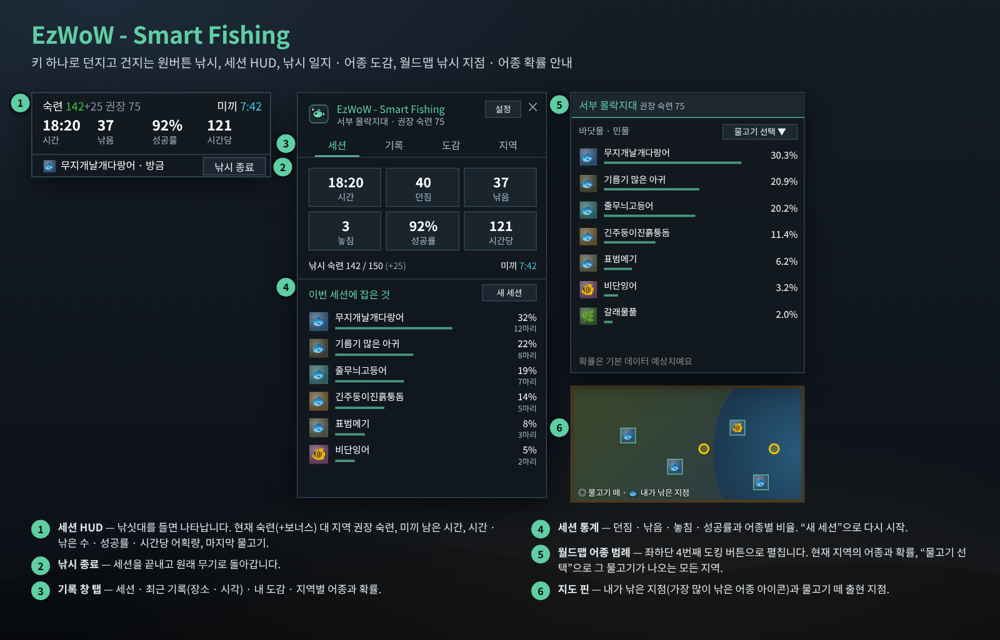
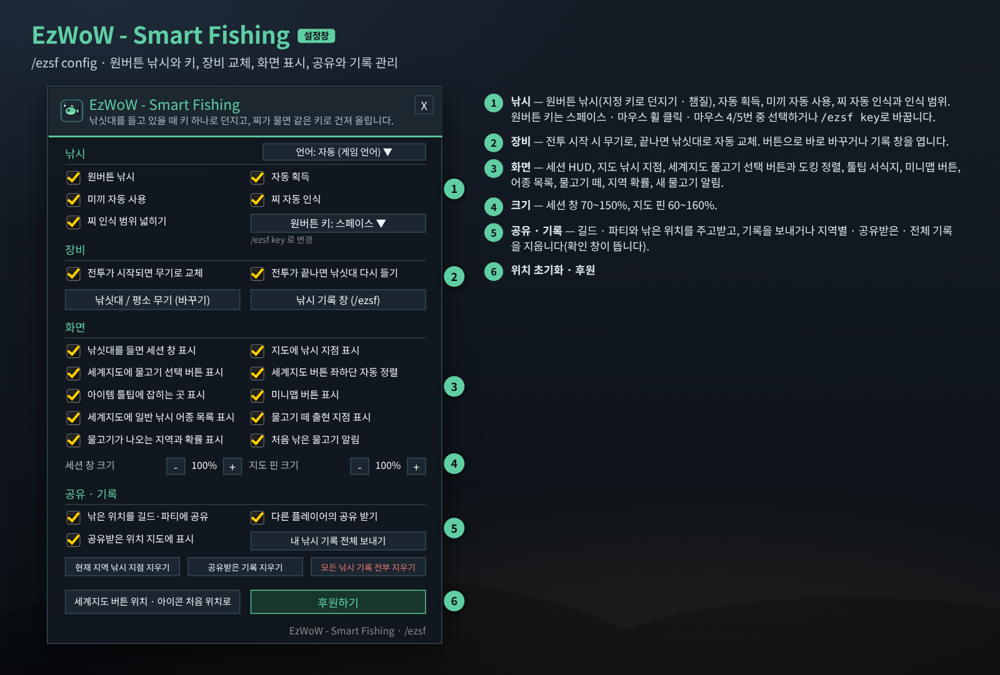
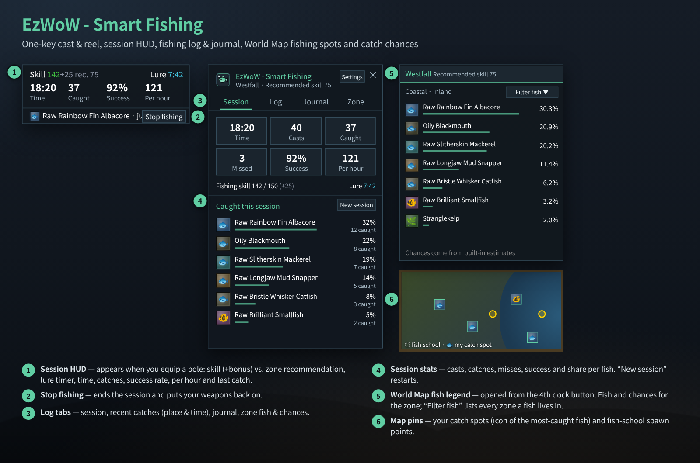
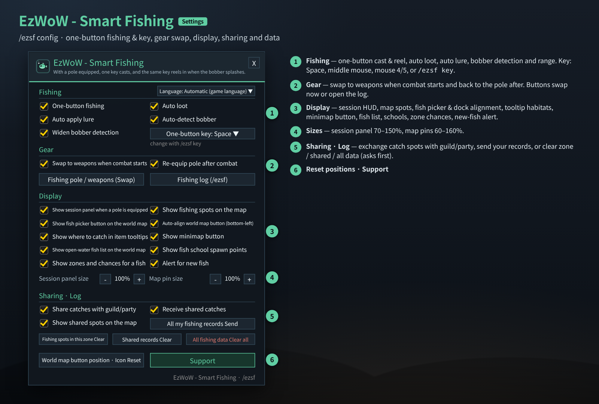
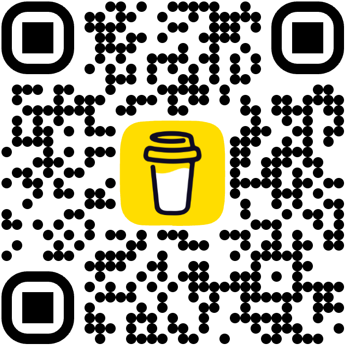

# EzWoW - Smart Fishing (`EzWoW-SmartFishing`)

## CurseForge

- **Project ID / 프로젝트 ID:** `1743389`
- **Project page / 프로젝트 페이지:** [EzWoW-SmartFishing](https://www.curseforge.com/wow/addons/wowsmartfishing)

**[한국어](#한국어) · [English](#english)**

WoW Forever (`Interface: 16001`) · `/ezsf`

---

## 한국어

### 개요

낚시를 편하게 해 주는 올인원 애드온입니다. 낚싯대를 들고 **키 하나(기본 스페이스)**로 던지고, 찌가 물면 같은 키로 건져 올립니다. 미끼 자동 사용, 낚싯대 ↔ 평소 무기 원클릭 교체, 실시간 세션 HUD, 낚시 일지 · 어종 도감, 월드맵 낚시 지점 · 물고기 떼 · 지역별 어종 확률, 파티·길드 기록 공유까지 제공합니다.

### 화면 미리보기

> 이미지는 애드온 코드의 창 크기·좌표·색상·문구로 재현한 **예시 화면**입니다. 어종과 확률은 애드온에 들어 있는 **서부 몰락지대** 데이터이고, 세션 숫자는 예시입니다.

### 설치

1. `EzWoW-SmartFishing` 폴더를 `Interface/AddOns/` 폴더에 넣습니다.
2. 캐릭터 선택 화면의 **애드온** 목록에서 켭니다.
3. 미니맵 버튼 **좌클릭**(또는 `/ezsf pole`)으로 낚싯대를 들고, 물가에서 **스페이스**를 누르세요.

### 사용법 (위 그림의 번호)

| 번호 | 부분 | 설명 |
|---|---|---|
| ① | 세션 HUD | 낚싯대를 들면 나타납니다. **현재 숙련(+장비 보너스) / 지역 권장 숙련**, 미끼 남은 시간, 세션 시간 · 낚은 수 · 성공률 · 시간당 어획량, 마지막으로 낚은 물고기를 보여 줍니다. 마우스로 끌어 옮길 수 있습니다. |
| ② | 낚시 종료 | 세션을 마치고 원래 주무기·보조무기로 돌아갑니다. |
| ③ | 기록 창 탭 (`/ezsf`) | **세션**(이번 세션 통계) · **기록**(최근에 낚은 물고기와 장소 · 시각) · **도감**(처음 낚은 날 · 장소 · 마리 수) · **지역**(현재 지역 어종과 기대 확률, “지도 열기”) |
| ④ | 세션 통계 | 시간 · 던짐 · 낚음 · 놓침 · 성공률 · 시간당과 어종별 비율. **새 세션**으로 다시 시작합니다. |
| ⑤ | 월드맵 어종 범례 | 세계지도 왼쪽 아래 **4번째 도킹 버튼**으로 펼칩니다. 현재 지역의 바닷물·민물 어종과 확률을 보여 주고, **물고기 선택**으로 특정 물고기가 나오는 **모든 지역과 확률**을 찾습니다. |
| ⑥ | 지도 핀 | 내가 물고기를 낚은 지점(가장 많이 낚은 어종 아이콘)과 내장된 **물고기 떼 출현 지점**을 표시합니다. 공유받은 지점도 표시할 수 있습니다. |

#### 원버튼 낚시 동작

1. 낚싯대를 든 상태에서 원버튼 키를 누르면 **낚시를 던집니다**.
2. 찌가 물면 같은 키를 눌러 **건져 올립니다**(찌 자동 인식). 인식이 안 되면 마우스를 찌에 올리고 키를 누르세요.
3. **자동 획득**이 켜져 있으면 전리품을 자동으로 줍습니다.
4. 미끼 효과가 없거나 끝나면 가방에서 **가장 좋은 미끼**를 찾아 자동으로 바릅니다.

- 원버튼 키는 낚싯대를 들고 있을 때만 바뀌므로, 평소에는 스페이스(점프)가 그대로 동작합니다.
- 전투가 시작되면 무기로, 끝나면 다시 낚싯대로 자동 교체할 수 있습니다.
- 물고기 아이템 툴팁에는 주요 서식 지역과 확률이 나옵니다.

### 설정창 (`/ezsf config`)

| 번호 | 항목 | 기본값 |
|---|---|---|
| ① | 언어 (자동 + 8개 언어) | 자동 |
| ① | 원버튼 낚시 · 자동 획득 · 미끼 자동 사용 · 찌 자동 인식 · 찌 인식 범위 넓히기 | 모두 켬 |
| ① | 원버튼 키: 스페이스 · 마우스 휠 클릭 · 마우스 4번 · 마우스 5번 (또는 `/ezsf key 키`) | 스페이스 |
| ② | 전투가 시작되면 무기로 교체 · 전투가 끝나면 낚싯대 다시 들기 | 켬 · 켬 |
| ② | 버튼: 낚싯대 / 평소 무기 (바꾸기) · 낚시 기록 창 (/ezsf) | - |
| ③ | 낚싯대를 들면 세션 창 표시 · 지도에 낚시 지점 표시 | 켬 |
| ③ | 세계지도에 물고기 선택 버튼 표시 · 세계지도 버튼 좌하단 자동 정렬 | 켬 |
| ③ | 아이템 툴팁에 잡히는 곳 표시 · 미니맵 버튼 표시 | 켬 |
| ③ | 세계지도에 일반 낚시 어종 목록 표시 · 물고기 떼 출현 지점 표시 | 켬 |
| ③ | 물고기가 나오는 지역과 확률 표시 · 처음 낚은 물고기 알림 | 켬 |
| ④ | 세션 창 크기 70~150% · 지도 핀 크기 60~160% | 100% · 100% |
| ⑤ | 낚은 위치를 길드·파티에 공유 · 다른 플레이어의 공유 받기 · 공유받은 위치 지도에 표시 | 켬 |
| ⑤ | 내 낚시 기록 전체 보내기 / 현재 지역 낚시 지점 지우기 / 공유받은 기록 지우기 / 모든 낚시 기록 전부 지우기 (확인 창이 뜹니다) | - |
| ⑥ | 세계지도 버튼 위치 · 아이콘 처음 위치로 · 후원하기 | - |

### 명령어 (`/ezsf`, `/스마트낚시`)

| 명령어 | 설명 |
|---|---|
| `/ezsf` | 낚시 기록 · 도감 창 |
| `/ezsf config` (`설정`) | 설정창 |
| `/ezsf onebutton` (`원버튼`) | 원버튼 낚시 켜기/끄기 |
| `/ezsf key 키` (`키`) | 원버튼 키 변경 (예: `/ezsf key F`) |
| `/ezsf lure` (`미끼`) · `/ezsf pins` (`핀`) · `/ezsf hud` | 자동 미끼 · 지도 핀 · 세션 HUD 켜기/끄기 |
| `/ezsf pole` (`gear`, `장비`) | 가장 좋은 낚싯대 들기 / 원래 무기로 복귀 |
| `/ezsf session` (`세션`) | 세션 통계 새로 시작 |
| `/ezsf reset` · `/ezsf reset all` | 현재 지역 낚시 지점 지우기 · 모든 기록 지우기 |
| `/ezsf lang <auto\|ko\|en\|de\|fr\|es\|ru\|cn\|tw>` | 표시 언어 변경 |
| `/ezsf donate` (`후원`) | 후원 안내 |

미니맵 버튼: **좌클릭** 낚싯대/무기 교체 · **우클릭** 설정 · **드래그** 이동

### 저장 데이터

- `EzWoW_SmartFishingDB`: 설정, 낚시 지점, 기록, 도감, 세션, 공유받은 기록.

---

## English

### Overview

An all-in-one fishing helper. With a pole equipped, **one key (Space by default)** casts, and the same key reels in when the bobber splashes. It also auto-applies lures, swaps pole ↔ weapons in one click, shows a live session HUD, keeps a fishing log and journal, marks fishing spots, fish schools and per-zone catch chances on the World Map, and shares catches with your party and guild.

### Screenshots

> These are **mock-ups** rebuilt from the window sizes, coordinates, colours and strings in the code. Fish and chances are the bundled **Westfall** data; session numbers are examples.

### Installation

1. Copy the `EzWoW-SmartFishing` folder into `Interface/AddOns/`.
2. Enable it in the **AddOns** list on the character select screen.
3. **Left-click** the minimap button (or `/ezsf pole`) to equip your pole, stand by water and press **Space**.

### How to use (numbers in the picture)

| No. | Part | Description |
|---|---|---|
| ① | Session HUD | Appears when you equip a pole: **your skill (+gear bonus) vs. the zone's recommended skill**, lure timer, session time, catches, success rate, catches per hour and your last catch. Drag to move. |
| ② | Stop fishing | Ends the session and puts your main/off-hand weapons back on. |
| ③ | Log tabs (`/ezsf`) | **Session** (this session) · **Log** (recent catches with place and time) · **Journal** (first catch date, place, count) · **Zone** (fish and expected chances here, “Open map”) |
| ④ | Session stats | Time, casts, caught, missed, success, per hour and share per fish. **New session** restarts. |
| ⑤ | World Map fish legend | Opened from the **4th dock button** at the bottom-left of the World Map. Shows coastal/inland fish and chances for the zone; **Filter fish** lists **every zone and chance** for one fish. |
| ⑥ | Map pins | Your catch spots (icon of the most-caught fish) and built-in **fish school spawn points**. Shared spots can be shown too. |

#### How one-button fishing works

1. With a pole equipped, press the key to **cast**.
2. When the bobber splashes, press the same key to **reel in** (bobber auto-detect). If it is not detected, put the mouse over the bobber and press the key.
3. With **Auto loot** on, loot is picked up automatically.
4. If there is no lure (or it ran out), the **best lure** in your bags is applied.

- The key is only rebound while a pole is equipped, so Space still jumps normally otherwise.
- You can swap to weapons when combat starts and back to the pole afterwards.
- Fish item tooltips list their main zones and chances.

### Settings window (`/ezsf config`)

| No. | Option | Default |
|---|---|---|
| ① | Language (Auto + 8 languages) | Auto |
| ① | One-button fishing · Auto loot · Auto apply lure · Auto-detect bobber · Widen bobber detection | All on |
| ① | One-button key: Space · middle mouse · mouse 4 · mouse 5 (or `/ezsf key KEY`) | Space |
| ② | Swap to weapons when combat starts · Re-equip pole after combat | On · On |
| ② | Buttons: Fishing pole / weapons (Swap) · Fishing log (/ezsf) | - |
| ③ | Show session panel when a pole is equipped · Show fishing spots on the map | On |
| ③ | Show fish picker button on the world map · Auto-align world map button (bottom-left) | On |
| ③ | Show where to catch in item tooltips · Show minimap button | On |
| ③ | Show open-water fish list on the world map · Show fish school spawn points | On |
| ③ | Show zones and chances for a fish · Alert for new fish | On |
| ④ | Session panel size 70–150% · Map pin size 60–160% | 100% · 100% |
| ⑤ | Share catches with guild/party · Receive shared catches · Show shared spots on the map | On |
| ⑤ | Send all my records / Clear spots in this zone / Clear shared records / Clear all fishing data (asks to confirm) | - |
| ⑥ | Reset world map button & icon position · Support | - |

### Slash commands (`/ezsf`, `/스마트낚시`)

| Command | Description |
|---|---|
| `/ezsf` | Fishing log & journal |
| `/ezsf config` | Settings |
| `/ezsf onebutton` | Toggle one-button fishing |
| `/ezsf key KEY` | Change the one-button key (e.g. `/ezsf key F`) |
| `/ezsf lure` · `/ezsf pins` · `/ezsf hud` | Toggle auto lure · map pins · session HUD |
| `/ezsf pole` (`gear`) | Equip the best pole / go back to weapons |
| `/ezsf session` | Start a new session |
| `/ezsf reset` · `/ezsf reset all` | Clear spots in this zone · clear all data |
| `/ezsf lang <auto\|ko\|en\|de\|fr\|es\|ru\|cn\|tw>` | Change display language |
| `/ezsf donate` | Support info |

Minimap button: **left-click** swap pole/weapons · **right-click** settings · **drag** move

### Saved data

- `EzWoW_SmartFishingDB`: settings, fishing spots, log, journal, sessions and shared records.

---

## Support / 후원

If you find this addon useful, you can support its development.

애드온이 도움이 되셨다면 개발 후원으로 응원해 주세요.

[Buy Me a Coffee ☕](https://buymeacoffee.com/qqhrqqhr2)

