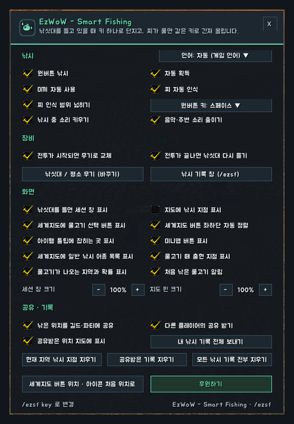
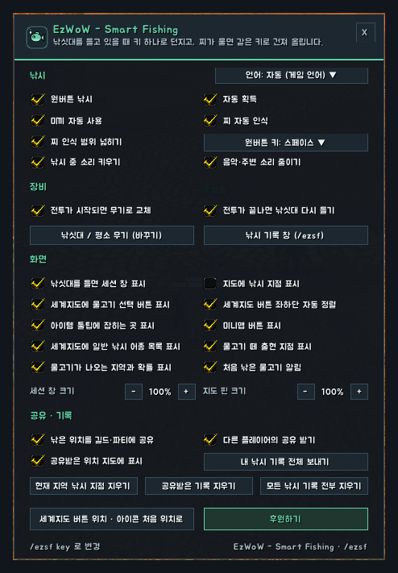

<!--
CurseForge summary (EN): One-button fishing, auto lure and pole swap, session HUD with louder fishing sound, catch log and journal, and fish spots, schools and chances on the World Map.
CurseForge summary (KO): 원버튼 낚시, 자동 미끼·낚싯대 교체, 낚시 소리를 키우는 세션 HUD, 낚시 일지·도감, 세계지도의 낚시 지점·물고기 떼·어종 확률.
-->

# EzWoW - Smart Fishing

**English** · [한국어](#한국어)

An all-in-one fishing helper for WoW Forever. With a pole equipped, one key (Space by default) casts and the same key reels in when the bobber splashes. It applies lures for you, swaps between your pole and weapons, makes the splash easy to hear, keeps a log and journal of your catches, and shows fishing spots, fish schools and catch chances on the World Map.

*In-game screenshots (WoW Forever, Korean client). Character and player names and chat text are blurred.*

## Features

### One-button fishing
- With a pole equipped, press the key to cast; when the bobber splashes, press it again to reel in (the bobber is detected automatically).
- If the bobber is not detected, put the mouse over it and press the key.
- The key is only taken over while a pole is equipped and you stand still, so Space still jumps while moving.
- Choose Space, F, G, R, T, V, middle mouse or mouse 4/5 in the settings, or any key with `/ezsf key KEY`.
- Auto loot, and a wider bobber detection range and angle (your own settings come back when you take the pole off).

### Lures and gear
- If there is no lure on the pole, the best lure in your bags that your skill allows is applied first.
- One click equips your best pole and puts your weapons back when you are done; chat tells you what was swapped.
- Swap to weapons when combat starts and back to the pole when it ends.

### Session HUD and fishing sound
- A small panel while a pole is equipped: your skill (with gear bonus) against the zone's recommended skill, lure timer, time, catches, success rate, catches per hour and your last catch.
- **Fishing sound**: sound effects get louder only while your line is out, so the splash is easy to hear. Set 10–200% with +/- (above 100% the master volume goes up too); your volume comes back when fishing ends. Music and ambience can be muted while fishing (off by default).
- **Mini games** button: a small game while you wait for a bite. The window takes no keys, so the one-button key keeps fishing.
- **Stop fishing** ends the session and puts your weapons back on.

### Log and journal (`/ezsf`)
- **Session**: time, casts, caught, missed, success, per hour and the share of each fish.
- **Log**: recent catches with place and time; click to see the spot on the map.
- **Journal**: every fish you have caught, with the first date, place and count. New fish are announced.
- **Zone**: fish and expected chances where you stand, with the recommended skill.

### World Map
- A button at the bottom-left of the World Map opens the fish legend: open-water fish and chances for the zone, a pin toggle and settings.
- **Filter fish**: pick a fish to see only its spots and the zones where it is caught, with chances; continent maps rank the best zones.
- Pins for your catch spots (icon of the most-caught fish), built-in fish school spawn points (blue rim) and spots shared by others (gold rim).

### Tooltips
- Fish tooltips list the three best zones with chances, zones with fish schools, and how many you have caught.

### Sharing
- Share catch spots with guild and party members who use the addon, receive theirs, and show them on the map.
- Send all your records at once, or clear this zone, shared records or everything (asks to confirm).

## Working with other EzWoW addons
- The mini games are the same as in **EzWoW - Flight Map**.
- When **EzWoW - Tooltip** already shows where an item comes from, the fish tooltip only adds your catch count.

## Gamepad
- With the gamepad UI on, EzWoW windows work with a gamepad: D-pad to move, A (✕) to press, X (□) for right-click, LB/RB to scroll, B (○) to close. A key guide in your pad's button style shows under the window.
- With no game window open, press **View (Back) / Create** to move to the EzWoW frames on screen. Press it again or B to go back.
- On the World Map, View / Create moves to the EzWoW icons at the bottom left.
- To use another button: Key Bindings > AddOns > EzWoW > "Gamepad: move to / leave the EzWoW frames" (with EzWoW-MapFinder installed).

## Record sharing
- Shared by all EzWoW addons and **on by default**: quest NPCs, rare monster sightings, item drops and gathering spots you have seen yourself are shared with other EzWoW users.
- `/ezshare on` / `off`, `/ezshare channel on` / `off`, `/ezshare status`

## Commands
- `/ezsf` or `/스마트낚시` — fishing log & journal
- `/ezsf config` — settings
- `/ezsf pole` — equip the best pole / go back to weapons
- `/ezsf key KEY` — change the one-button key (e.g. `/ezsf key F`)
- `/ezsf onebutton` · `/ezsf lure` · `/ezsf pins` · `/ezsf hud` — toggle one-button fishing, auto lure, map pins, session HUD
- `/ezsf session` — start a new session
- `/ezsf reset` · `/ezsf reset all` — clear spots in this zone · clear all spots
- `/ezsf lang auto|ko|en|de|fr|es|ru|cn|tw` — change the language

Minimap button: left-click swaps pole/weapons, right-click opens the settings, drag to move.

Languages: English, 한국어, Deutsch, Français, Español, Русский, 简体中文, 繁體中文.

---

## 한국어

WoW Forever용 올인원 낚시 애드온입니다. 낚싯대를 들고 키 하나(기본 스페이스)로 던지고, 찌가 물면 같은 키로 건져 올립니다. 미끼를 알아서 바르고, 낚싯대와 무기를 바꿔 주고, 찌 소리를 잘 들리게 하며, 낚시 일지와 도감을 남기고, 세계지도에 낚시 지점 · 물고기 떼 · 어종 확률을 보여 줍니다.

*실제 게임 화면입니다(WoW Forever, 한국어 클라이언트). 캐릭터 · 다른 플레이어 이름과 채팅 내용은 가렸습니다.*

## 기능

### 원버튼 낚시
- 낚싯대를 든 채 키를 누르면 던지고, 찌가 물면 다시 눌러 건져 올립니다(찌 자동 인식).
- 찌가 인식되지 않으면 마우스를 찌에 올리고 키를 누르세요.
- 키는 낚싯대를 들고 멈춰 서 있을 때만 바뀌므로, 이동 중에는 스페이스로 그대로 점프합니다.
- 설정에서 스페이스 · F · G · R · T · V · 마우스 휠 클릭 · 마우스 4/5번을 고르거나, `/ezsf key 키`로 아무 키나 지정합니다.
- 자동 획득, 찌 인식 거리 · 각도 넓히기(낚싯대를 벗으면 원래 설정으로 돌아갑니다).

### 미끼와 장비
- 낚싯대에 미끼가 없으면 내 숙련으로 쓸 수 있는 가방 속 가장 좋은 미끼를 먼저 바릅니다.
- 클릭 한 번으로 가장 좋은 낚싯대를 들고, 끝나면 원래 무기로 돌아갑니다. 무엇을 바꿨는지 채팅으로 알려 줍니다.
- 전투가 시작되면 무기로, 끝나면 다시 낚싯대로 바꿉니다.

### 세션 HUD와 낚시 소리
- 낚싯대를 들면 작은 창이 나옵니다: 내 숙련(장비 보너스 포함)과 지역 권장 숙련, 미끼 남은 시간, 시간 · 낚은 수 · 성공률 · 시간당, 마지막으로 낚은 물고기.
- **낚시 소리**: 낚시를 던져 기다리는 동안만 효과음을 키워 찌 소리가 잘 들립니다. +/-로 10~200%(100%를 넘기면 주 음량까지 올림), 낚시가 끝나면 원래 음량으로 돌아갑니다. 낚시하는 동안 배경음악 · 주변 소리를 끌 수도 있습니다(기본 꺼짐).
- **미니게임** 버튼: 찌를 기다리는 동안 가볍게 한 판. 창이 키를 받지 않아 원버튼 키는 그대로 낚시에 쓰입니다.
- **낚시 종료**: 세션을 마치고 원래 무기로 돌아갑니다.

### 낚시 일지와 도감 (`/ezsf`)
- **세션**: 시간 · 던짐 · 낚음 · 놓침 · 성공률 · 시간당과 어종별 비율.
- **기록**: 최근에 낚은 물고기와 장소 · 시각. 클릭하면 지도에서 그 지점을 봅니다.
- **도감**: 낚은 모든 물고기의 처음 낚은 날 · 장소 · 마리 수. 새 물고기를 낚으면 알려 줍니다.
- **지역**: 지금 있는 지역의 어종과 기대 확률, 권장 숙련.

### 세계지도
- 세계지도 왼쪽 아래 버튼으로 어종 범례를 펼칩니다: 지역의 일반 낚시 어종과 확률, 핀 숨김, 설정.
- **물고기 선택**: 물고기를 고르면 그 물고기의 지점과 잡히는 지역 · 확률만 보여 줍니다. 대륙 지도에서는 잘 잡히는 지역 순위를 보여 줍니다.
- 내가 낚은 지점(가장 많이 낚은 어종 아이콘), 내장된 물고기 떼 출현 지점(파란 테두리), 공유받은 지점(금색 테두리)을 핀으로 표시합니다.

### 툴팁
- 물고기 툴팁에 잘 잡히는 지역 3곳과 확률, 물고기 떼가 나오는 지역, 내가 낚은 수를 표시합니다.

### 공유
- 같은 애드온을 쓰는 길드원 · 파티원과 낚은 위치를 주고받아 지도에 표시합니다.
- 내 기록 전체 보내기, 현재 지역 · 공유받은 기록 · 전체 기록 지우기(확인 창이 뜹니다).

## 다른 EzWoW 애드온과 함께 쓰기
- 미니게임은 **EzWoW - Flight Map**의 미니게임과 같습니다.
- **EzWoW - Tooltip**이 아이템 출처를 이미 보여 주면, 물고기 툴팁에는 내가 낚은 수만 덧붙입니다.

## 게임패드
- 게임패드 UI를 켜면 EzWoW 창을 패드로 다룰 수 있습니다. 방향키로 이동, A(✕)로 누르기, X(□)로 오른쪽 클릭, LB/RB로 스크롤, B(○)로 닫기입니다. 창 아래에 연결된 패드 모양으로 키 안내가 나옵니다.
- 블리자드 창이 열려 있지 않을 때 **보기(Back) / Create 버튼**을 누르면 화면의 EzWoW 프레임으로 이동합니다. 다시 누르거나 B를 누르면 돌아갑니다.
- 세계지도에서는 보기 / Create 버튼으로 왼쪽 아래 EzWoW 아이콘에 갑니다.
- 다른 버튼을 쓰려면: 설정 > 단축키 > 애드온 > EzWoW > "게임패드: EzWoW 창으로 이동/돌아가기" (EzWoW-MapFinder 설치 시)

## 기록 공유
- 모든 EzWoW 애드온이 함께 쓰며 **기본으로 켜져 있습니다**. 직접 확인한 퀘스트 NPC, 희귀 몬스터 목격, 아이템 드롭, 채집 위치를 다른 EzWoW 사용자와 나눕니다.
- `/ezshare on` / `off` (또는 `/공유`), `/ezshare channel on` / `off`, `/ezshare status`

## 명령어
- `/ezsf` 또는 `/스마트낚시` — 낚시 기록 · 도감 창
- `/ezsf config` (`설정`) — 설정창
- `/ezsf pole` (`장비`) — 가장 좋은 낚싯대 들기 / 원래 무기로
- `/ezsf key 키` — 원버튼 키 변경 (예: `/ezsf key F`)
- `/ezsf onebutton` · `/ezsf lure` · `/ezsf pins` · `/ezsf hud` — 원버튼 낚시 · 자동 미끼 · 지도 핀 · 세션 HUD 켜기/끄기
- `/ezsf session` (`세션`) — 새 세션 시작
- `/ezsf reset` · `/ezsf reset all` — 현재 지역 낚시 지점 지우기 · 모든 지점 지우기
- `/ezsf lang auto|ko|en|de|fr|es|ru|cn|tw` — 언어 변경

미니맵 버튼: 좌클릭 낚싯대/무기 교체 · 우클릭 설정 · 드래그 이동

지원 언어: English, 한국어, Deutsch, Français, Español, Русский, 简体中文, 繁體中文.

---

**Support:** If you find this addon useful, you can support its development. [Buy Me a Coffee ☕](https://buymeacoffee.com/qqhrqqhr2)

**후원:** 애드온이 도움이 되셨다면 개발 후원으로 응원해 주세요. [Buy Me a Coffee ☕](https://buymeacoffee.com/qqhrqqhr2)
